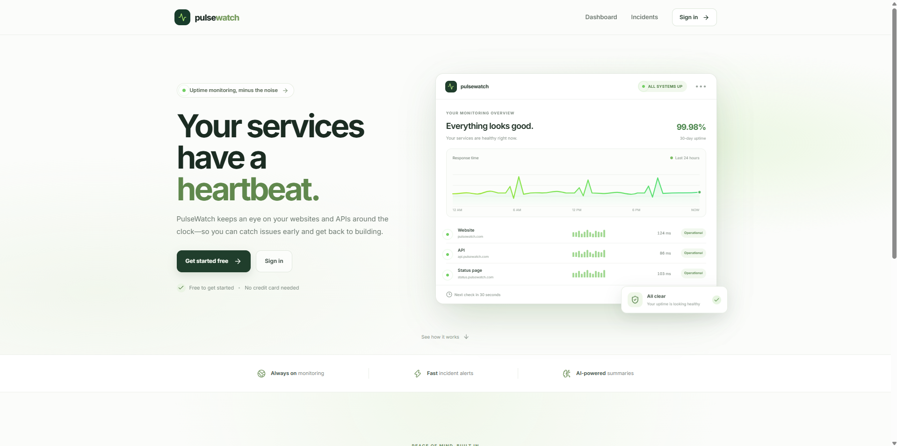
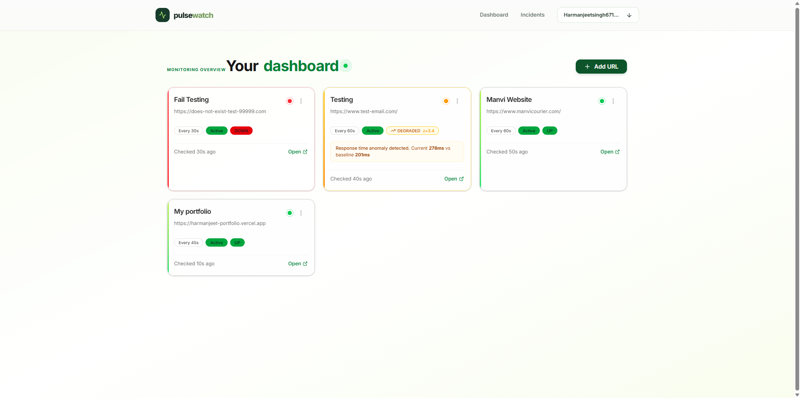
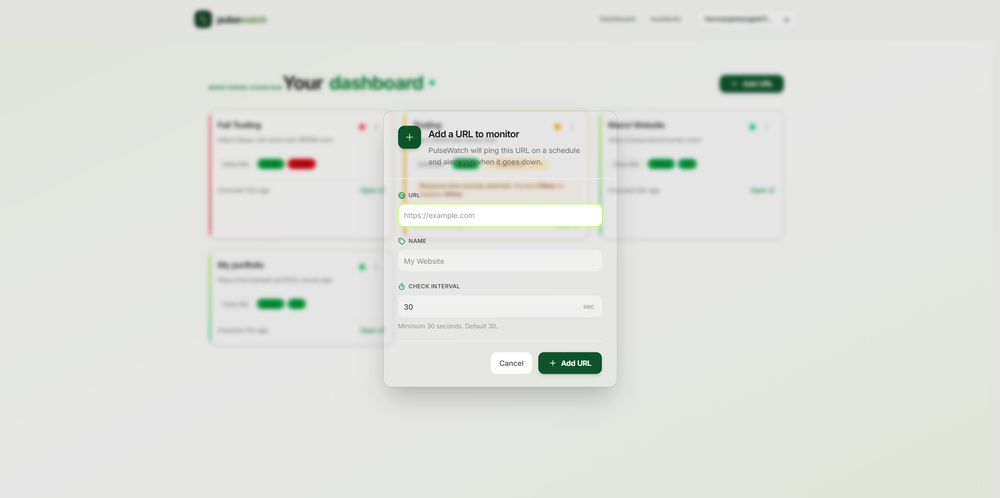
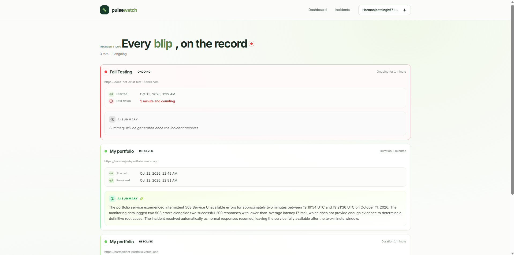
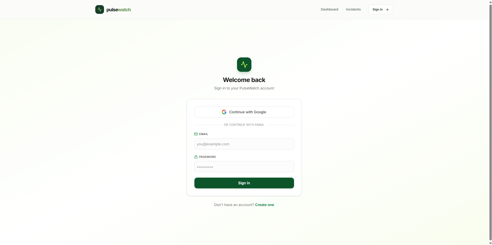

# PulseWatch Web

> Frontend for **PulseWatch** — a production uptime monitoring platform with AI-powered incident summaries and deterministic anomaly detection.

[](https://pulsewatch-web-seven.vercel.app)
[](https://vercel.com)
[](https://nextjs.org/)
[](./LICENSE)

**Live app:** [pulsewatch-web-seven.vercel.app](https://pulsewatch-web-seven.vercel.app)
**Backend API:** [pulsewatch-api-gktg.onrender.com](https://pulsewatch-api-gktg.onrender.com/health)

---

## What It Is

A Next.js dashboard that gives you a live view of every URL you monitor:

- **Dashboard** — status of all URLs at a glance (up / degraded / down)
- **URL detail** — ping history, uptime %, average response time
- **Incidents** — every outage with an AI-generated post-mortem
- **Add / Delete URLs** — full CRUD from the UI
- **Auth** — sign up with email/password or Google

---

## Screenshots

### Landing page



### Dashboard — three visual states



UP (green) / DEGRADED (amber, z-score anomaly) / DOWN (red).

### Add URL dialog



### Incidents with AI summaries



### Login page — Google + email/password



### URL detail with ping history


---

## Features

### Three-State Status System

Every URL card shows one of three states:

- **UP** (green) — last ping succeeded, response time is normal
- **DEGRADED** (amber) — last ping succeeded, but response time is anomalous (`z >= 3`)
- **DOWN** (red) — last ping failed

The degraded state comes from a rolling z-score computed on the backend. The card shows the actual z-score (`z=3.4`) and the baseline comparison (`Current 278ms vs baseline 201ms`).

### AI Incident Summaries

When an incident resolves, the backend calls Gemini to write a plain-English post-mortem. The incidents page displays it in a green-tinted card with a sparkle icon:

> "The portfolio service experienced intermittent 503 Service Unavailable errors for approximately two minutes between 19:19:54 UTC and 19:21:36 UTC on October 11, 2026. The monitoring data logged two 503 errors alongside two successful 200 responses with lower-than-average latency (71ms), which does not provide enough evidence to determine a definitive root cause. The incident resolved automatically as normal responses resumed, leaving the service fully available after the two-minute window."

### Polished UX

- Real-time updates (30s polling)
- Toast notifications for every action
- Confirmation dialogs for destructive actions
- Empty states, error states, loading skeletons
- Custom brand design system (green + neutral palette)
- Fully responsive — mobile, tablet, desktop

### Auth

- Email + password sign-up / sign-in (JWT)
- Continue with Google (OAuth)
- Session persistence via localStorage
- Auto-redirect to `/login` on 401
- Protected routes via `AuthGuard`

---

## Tech Stack

| Layer | Tool |
|---|---|
| Framework | Next.js 16 (App Router) |
| Language | TypeScript |
| Styling | Tailwind CSS |
| Components | shadcn/ui |
| Forms | React Hook Form + Zod |
| Notifications | Sonner |
| Dates | date-fns |
| Icons | Lucide |
| Deployment | Vercel |

---

## Project Structure

```
app/
  layout.tsx                Root layout with nav
  page.tsx                  Landing page
  login/page.tsx            Login (email + Google)
  register/page.tsx         Register (email + Google)
  auth/callback/page.tsx    OAuth callback handler
  dashboard/page.tsx        URL grid
  urls/[id]/page.tsx        URL detail with ping history
  incidents/page.tsx        Incidents with AI summaries

components/
  auth/
    AuthGuard.tsx           Redirects unauthenticated users
    NavAuth.tsx             Sign-in button / user dropdown
  urls/
    AddUrlDialog.tsx        Add URL modal
    UrlCard.tsx             URL card with status + actions
  ui/                       shadcn components

lib/
  api.ts                    Typed API client
  auth.ts                   JWT storage + session helpers
```

---

## Local Development

### Prerequisites

- Node.js 20+
- pnpm
- The backend running locally **or** the [live backend](https://pulsewatch-api-gktg.onrender.com)

### Setup

```bash
git clone https://github.com/HarmanjeetSingh2501/pulsewatch-web.git
cd pulsewatch-web
pnpm install
cp .env.example .env.local
# Edit .env.local — set NEXT_PUBLIC_API_URL
pnpm dev
```

App runs on `http://localhost:3001`.

### Environment Variables

| Variable | Required | Value |
|---|---|---|
| `NEXT_PUBLIC_API_URL` | Yes | Backend URL (`http://localhost:3000` locally, Render URL in production) |

---

## Design System

- **Primary:** Deep green (`#183c2b`)
- **Accent:** Lime green (`#a9e66b`)
- **Background:** Off-white (`#fbfcfa`)
- **Text:** Dark neutral (`#17251e`)
- **Radius:** `rounded-2xl` for cards, `rounded-xl` for inputs
- **Shadow:** Soft, multi-layer — grows on hover
- **Motion:** 200ms transitions, `-translate-y-1` lift on hover

---

## Where This Breaks

| Limitation | Why | Mitigation |
|---|---|---|
| No real-time push | 30s polling instead of WebSockets/SSE | Would add SSE or WebSocket connection |
| No optimistic updates | Waits for API response before updating | SWR would enable optimistic UI |
| Ping chart limited to 500 points | Performance | Would paginate + aggregate server-side |
| First load is slow | Render free-tier cold start (~30s) | cron-job.org keeps it warm; paid tier eliminates this |
| No dark mode yet | Not implemented | Trivial to add with Tailwind |
| `useSearchParams` needs Suspense | Next.js 16 requirement | Login page is wrapped in `<Suspense>` |

---

## Roadmap

- [x] Week 1 — Scaffold, landing page, API client
- [x] Week 2 — Dashboard, URL detail, CRUD, deploy
- [x] Week 3 — Degraded state (z-score), AI summary display
- [x] Week 4 — Auth UI (email/password + Google)
- [ ] Week 5 — Dark mode, mobile polish, keyboard shortcuts

---

## Related Repos

- **Backend:** [pulsewatch-api](https://github.com/HarmanjeetSingh2501/pulsewatch-api)
- **Live app:** [pulsewatch-web-seven.vercel.app](https://pulsewatch-web-seven.vercel.app)

---

## License

MIT — see [LICENSE](./LICENSE)